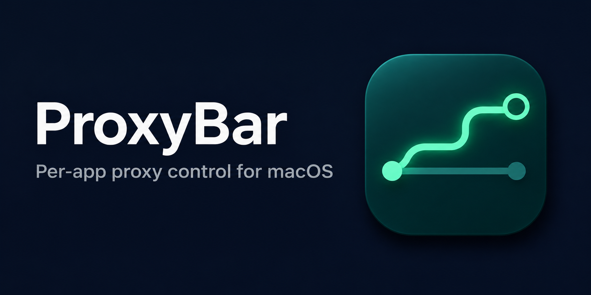

# ProxyBar

Launch selected Mac apps with your HTTP or SOCKS5 proxy. From the menu bar, you can check whether the proxy is reachable, see which services respond through it, and open a shell with the same proxy settings.

## Get started

You’ll need **macOS 14 or later**, a copy of **ProxyBar.app**, and the host and port of a running HTTP or SOCKS5 proxy.

1. **Open ProxyBar.** Move `ProxyBar.app` to Applications and open it in Finder. Look for the network icon in the menu bar.
2. **Connect your proxy.** In first-run setup, choose HTTP or SOCKS5 and enter the proxy’s host and port. Use `localhost` if the proxy runs on this Mac. Choose the apps and services you want to manage, then finish setup.
3. **Launch an app.** Click the menu bar icon and use the play button next to an app. If the app is already running, use the circular arrow on its row to quit and relaunch it with the proxy settings.

If the menu says **Not reachable**, check that your proxy is running and that the host and port match its settings. To revisit setup, click the gear button and choose **Proxy → Run setup again…**.

## Use the menu bar

- **Check services.** Click the refresh button next to the region summary to check your proxy’s exit country and the services you selected. Open **Settings → Region** for individual results, custom endpoints, and automatic checks.
- **Open a terminal with the proxy.** Click the terminal icon and pick a folder, or choose **Copy shell exports** for an existing shell. Select an installed terminal in **Settings → Proxy**. ProxyBar supports Terminal, iTerm, Ghostty, and Kitty.
- **Manage apps and alerts.** Add more apps or configure per-app startup in **Settings → Apps**. Enable login startup and alerts for proxy outages, recovery, or newly blocked services in **Settings → Proxy**.

**Proxy configured** means ProxyBar found matching proxy settings in the app’s environment. Each app decides which requests honor those settings. Region checks use the proxy, and you can opt in to a direct comparison in **Settings → Region**.

## Project links

[Release history](docs/PROGRESS.md#changelog) · [Build from source and contribute](CONTRIBUTING.md)
